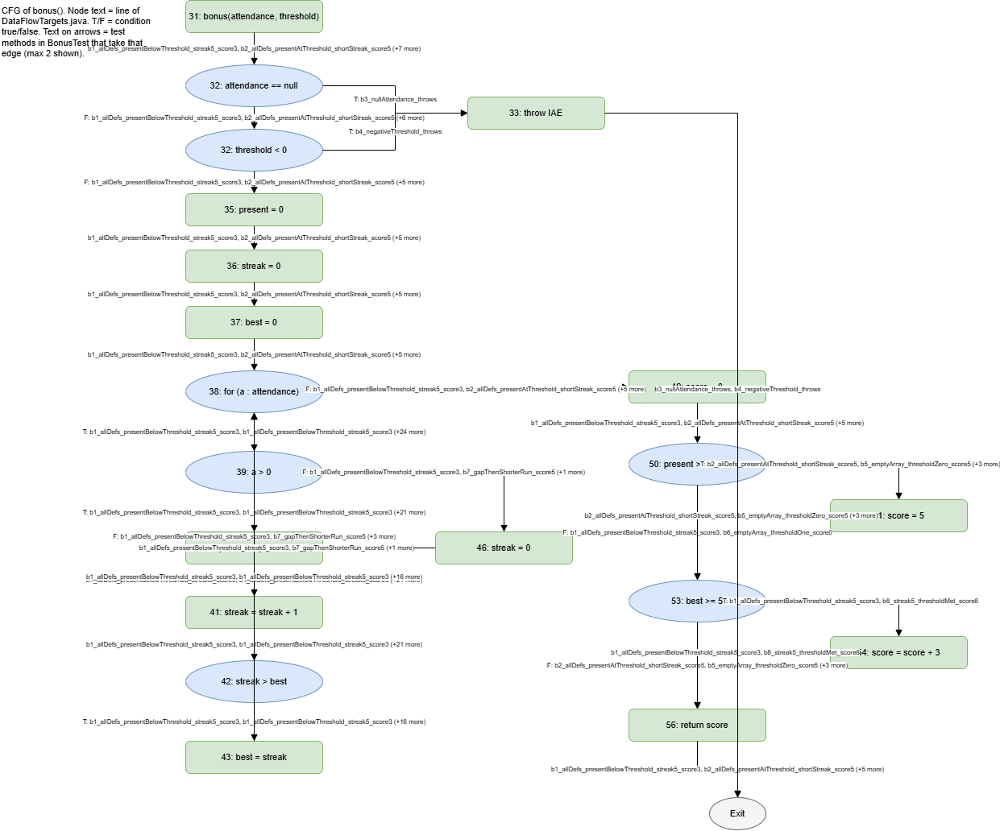

# Lab10 - Өгөгдлийн урсгалын тест: Definition-Use хосууд

Нэр: Ц.Төгөлдөр Оюутны код: B232270050

## Орчин

```
$ java -version
openjdk version "17.0.21.0.3" 2026-10-24
OpenJDK Runtime Environment (build 17.0.21.0.3+1-1-24.04.1-Ubuntu)
OpenJDK 64-Bit Server VM (build 17.0.21.0.3+1-1-24.04.1-Ubuntu, mixed mode, sharing)
```

```
$ mvn -version
Apache Maven 3.9.11 (3e54c93a704957b63ee3494413a2b544fd3d825b)
Maven home: /mnt/d/Program Files/Apache/Maven/apache-maven-3.9.11
Java version: 17.0.21.0.3, vendor: Ubuntu, runtime: /usr/lib/jvm/java-17-openjdk-amd64
Default locale: en, platform encoding: UTF-8
OS name: "linux", version: "6.18.58.1-microsoft-standard-wsl2", arch: "amd64", family: "unix"
```

## AI-ийн хэрэглээ

Тестийн код (`GcdTest`, `BonusTest`), DU хосын шинжилгээний ноорог, `cfg-bonus.png`-ийн draw.io ноорог (зангилаа, ирмэг, ирмэг дээрх тестийн нэр) болон энэ README-ийн загварыг AI туслахтай (Claude) хамтран бэлтгэсэн. Би бүх `mvn` командыг өөрөө ажиллуулж `results/`-ийн гаралтыг хадгалсан, 3 мутацийг `DataFlowTargets.java` дээр өөрөө хийж `git restore`-оор буцаасан, draw.io-ийн ноорогийг кодтой тулгаж PNG болгон экспортолсон. M3-ийн анхааруулгыг VS Code-ийн оронд Eclipse-ийн компайлер (`ecj`) -оор гаргасан тул `results/static-analysis-M3.txt`-д бодит гаралт хадгалагдсан.

## Хэсэг A: gcd

`DataFlowTargets.java`-ийн мөрийн дугаар (Лекцийн 1→13, 3→15, 4→16, 5→17, 6→18, 8→20):

```
13  def: x, y                (параметр)
15  p-use: y                 (while y != 0)
16  c-use: x, y;  def: tmp   (tmp = x % y)
17  c-use: y;     def: x     (x = y)
18  c-use: tmp;   def: y     (y = tmp)
20  c-use: x                 (return x)
```

DU хосын хүснэгт (p-use-ийн T/F салааг тусад нь тоолсон; `tmp`-ийн ганц def нь 16):

| Хувьсагч | Def мөр | Use мөр | c/p-use | Def-clear зам | Тест | Хамрагдсан |
|---|---|---|---|---|---|---|
| x | 13 | 16 | c-use | 13→15→16 | G2, G3 | ✓ |
| x | 13 | 20 | c-use | 13→15→20 | G1 | ✓ |
| x | 17 | 16 | c-use | 17→18→15→16 | G2 | ✓ |
| x | 17 | 20 | c-use | 17→18→15→20 | G2, G3 | ✓ |
| y | 13 | 15 | p-use T | 13→15→16 | G2, G3 | ✓ |
| y | 13 | 15 | p-use F | 13→15→20 | G1 | ✓ |
| y | 13 | 16 | c-use | 13→15→16 | G2, G3 | ✓ |
| y | 13 | 17 | c-use | 13→15→16→17 | G2, G3 | ✓ |
| y | 18 | 15 | p-use T | 18→15→16 | G2 | ✓ |
| y | 18 | 15 | p-use F | 18→15→20 | G2, G3 | ✓ |
| y | 18 | 16 | c-use | 18→15→16 | G2 | ✓ |
| y | 18 | 17 | c-use | 18→15→16→17 | G2 | ✓ |
| tmp | 16 | 18 | c-use | 16→17→18 | G2, G3 | ✓ |

Нийт 13 мөр (11 хос, p-use-ийн хоёр хос T/F-ээр хуваагдсан). `GcdTest`-ийн тестүүд (нэр/`@DisplayName`-д хамарсан хосууд файлын мөрийн дугаараар бичигдсэн):

| ID | Тест | Оролт |
|---|---|---|
| G1 | `g1_zeroIterations_gcd7and0_is7` | gcd(7,0)=7, давталт 0 удаа |
| G2 | `g2_twoIterations_gcd12and8_is4` | gcd(12,8)=4, давталт 2 удаа |
| G3 | `g3_oneIteration_gcd0and5_is5` | gcd(0,5)=5, давталт 1 удаа |

`gcd(7,0)` нь давталт огт ажиллахгүй тул `x(13→20)` ба `y(13→15 F)` гэсэн хоёр хосыг ГАНЦААРАА хамардаг. `gcd(12,8)` нь (12,8) → (8,4) → (4,0) гэж 2 удаа давтдаг; `x(17→16)`, `y(18→15 T)`, `y(18→16)`, `y(18→17)` хосууд давталтын хоёр дахь алхам шаарддаг (17, 18-р мөрийн def дараагийн алхамд л use-д хүрдэг), `G1`-ийн хоёр хосоос бусад бүх хос (11) давталтын дор хаяж нэг алхам шаарддаг.

## Хэсэг B: bonus

### B1: CFG



Зангилаа бүр `DataFlowTargets.java`-ийн мөрийн дугаартай (жишээ нь "42: streak > best"). Мөр 32-ын `||`-ийг богино залгалтаар хоёр зангилаа (`attendance == null`, `threshold < 0`) болгосон; мөр 38-ын for-each-ийн нөхцөл нь attendance-ийн p-use, алхам нь `a`-ийн def. Ирмэг бүрийн хажууд `BonusTest`-ийн бодит тестийн нэр бий (хоёроос олон тест дайрвал "+N more").

### B2: def/use жагсаалт

```
31  def: attendance, threshold                       (параметр)
32  p-use: attendance (== null), threshold (< 0)     (|| богино залгалт)
35  def: present
36  def: streak
37  def: best
38  p-use: attendance (дараагийн элемент байгаа эсэх); def: a (алхам бүрд)
39  p-use: a
40  c-use: present; def: present
41  c-use: streak;  def: streak
42  p-use: streak, best
43  c-use: streak;  def: best
46  def: streak            <- KILL: streak-ийн 36 ба 41-ийн def-ийг алдна
49  def: score
50  p-use: present, threshold
51  def: score             <- KILL: 49-ийн score-ийг алдна
53  p-use: best
54  c-use: score; def: score
56  c-use: score
```

### B3: DU хосын хүснэгт

Тестүүд (`BonusTest`):

| ID | Тест | Оролт → үр дүн |
|---|---|---|
| B1 | `b1_allDefs_presentBelowThreshold_streak5_score3` | `{1,1,1,1,1,0,1}`, 10 → 3 |
| B2 | `b2_allDefs_presentAtThreshold_shortStreak_score5` | `{1,1}`, 1 → 5 |
| B3 | `b3_nullAttendance_throws` | `null`, 3 → IllegalArgumentException |
| B4 | `b4_negativeThreshold_throws` | `{1,1}`, -1 → IllegalArgumentException |
| B5 | `b5_emptyArray_thresholdZero_score5` | `{}`, 0 → 5 |
| B6 | `b6_emptyArray_thresholdOne_score0` | `{}`, 1 → 0 |
| B7 | `b7_gapThenShorterRun_score5` | `{1,1,0,1}`, 1 → 5 |
| B8 | `b8_streak5_thresholdMet_score8` | `{1,1,1,1,1}`, 3 → 8 |
| B9 | `b9_killM2_longRunAfterGap_score5` | `{1,1,1,0,1,1,1,1}`, 1 → 5 (M2-ийг унагаах, Хэсэг C) |

Def-clear замтай бүх хос (p-use-ийн T/F салаа тусад нь; зам дахь тоо нь файлын мөр, `(43)` нь заавал биш мөр):

| Хувьсагч | Def мөр | Use мөр | c/p-use | Def-clear зам | Тест | Хамрагдсан |
|---|---|---|---|---|---|---|
| attendance | 31 | 32 | p-use F | 31→32→35 | B1, B2, B4, B5, B6, B7, B8, B9 | ✓ |
| attendance | 31 | 32 | p-use T | 31→32→33 | B3 | ✓ |
| attendance | 31 | 38 | p-use F | 31→32→35→36→37→38→49 | B1, B2, B5, B6, B7, B8, B9 | ✓ |
| attendance | 31 | 38 | p-use T | 31→32→35→36→37→38→39 | B1, B2, B7, B8, B9 | ✓ |
| threshold | 31 | 32 | p-use F | 31→32→35 | B1, B2, B5, B6, B7, B8, B9 | ✓ |
| threshold | 31 | 32 | p-use T | 31→32→33 | B4 | ✓ |
| threshold | 31 | 50 | p-use F | 31→…→38→49→50→53 | B1, B6 | ✓ |
| threshold | 31 | 50 | p-use T | 31→…→38→49→50→51 | B2, B5, B7, B8, B9 | ✓ |
| present | 35 | 40 | c-use | 35→36→37→38→39→40 | B1, B2, B7, B8, B9 | ✓ |
| present | 35 | 50 | p-use F | 35→36→37→38→49→50→53 | B6 | ✓ |
| present | 35 | 50 | p-use T | 35→36→37→38→49→50→51 | B5 | ✓ |
| present | 40 | 40 | c-use | 40→41→42→(43)→38→39→40 | B1, B2, B7, B8, B9 | ✓ |
| present | 40 | 50 | p-use F | 40→41→42→(43)→38→49→50→53 | B1 | ✓ |
| present | 40 | 50 | p-use T | 40→41→42→(43)→38→49→50→51 | B2, B7, B8, B9 | ✓ |
| streak | 36 | 41 | c-use | 36→37→38→39→40→41 | B1, B2, B7, B8, B9 | ✓ |
| streak | 41 | 41 | c-use | 41→42→(43)→38→39→40→41 | B1, B2, B7, B8, B9 | ✓ |
| streak | 41 | 42 | p-use F | 41→42→38 | B1, B7, B9 | ✓ |
| streak | 41 | 42 | p-use T | 41→42→43 | B1, B2, B7, B8, B9 | ✓ |
| streak | 41 | 43 | c-use | 41→42→43 | B1, B2, B7, B8, B9 | ✓ |
| streak | 46 | 41 | c-use | 46→38→39→40→41 | B1, B7, B9 | ✓ |
| best | 37 | 42 | p-use T | 37→38→39→40→41→42→43 | B1, B2, B7, B8, B9 | ✓ |
| best | 37 | 53 | p-use F | 37→38→49→50→53→56 | B5, B6 | ✓ |
| best | 43 | 42 | p-use F | 43→38→39→40→41→42→38 | B1, B7, B9 | ✓ |
| best | 43 | 42 | p-use T | 43→38→39→40→41→42→43 | B1, B2, B7, B8, B9 | ✓ |
| best | 43 | 53 | p-use F | 43→38→49→50→53→56 | B2, B7, B9 | ✓ |
| best | 43 | 53 | p-use T | 43→38→49→50→53→54 | B1, B8 | ✓ |
| score | 49 | 54 | c-use | 49→50→53→54 | B1 | ✓ |
| score | 49 | 56 | c-use | 49→50→53→56 | B6 | ✓ |
| score | 51 | 54 | c-use | 51→53→54 | B8 | ✓ |
| score | 51 | 56 | c-use | 51→53→56 | B2, B5, B7, B9 | ✓ |
| score | 54 | 56 | c-use | 54→56 | B1, B8 | ✓ |
| a | 38 | 39 | p-use F | 38→39→46 | B1, B7, B9 | ✓ |
| a | 38 | 39 | p-use T | 38→39→40 | B1, B2, B7, B8, B9 | ✓ |

Нийт 33 хамрагдах зүйл (23 хос, p-use-ийн салаа тусдаа). `a`-ийн use зөвхөн мөр 39-д.

**Kill (мөр 46 `streak = 0`).** Энэ мөр `streak`-ийн өмнөх def-ийг, 36 ба 41-ийг АЛДАГ. Иймээс def-clear зам байхгүй, DU хос БИШ дараах хослолууд: `streak(36→42)`, `streak(36→43)`, `streak(46→42)`, `streak(46→43)` - мөр 42, 43-д хүрэхийн өмнө үргэлж мөр 41 (шинэ def) дайрагддаг. Мөн `streak(41→41)` хос нь завсарлагагүй (46-г дайрахгүй) замаар л def-clear, иймээс B1/B7-д ирц дараалсан үед л хамрагдана. Мөр 51 `score = 5` нь 49-ийн score-ийг алддаг тул `score(49→54)` нь present < threshold үед (51 гүйцэтгэгдэхгүй) л боломжтой.

**Биелэшгүй салаа (2):**

- `best(37→42)` p-use **F**: 37-ийн `best = 0` хэвээр байхад мөр 41-ийн дараа `streak >= 1` тул `streak > best` үргэлж үнэн, худал болох боломжгүй.
- `best(37→53)` p-use **T**: 37-ийн def-тэй `best` нь ямар ч ирсэн өдөр (`a > 0`) байгаагүй гэсэн үг, `best = 0` тул `best >= 5` үнэн болох боломжгүй.

### B4: all-defs (хамгийн цөөн тест)

ALL-DEFS-д хувьсагч бүрийн def бүрээс дор хаяж нэг use хүртэл def-clear зам хамрагдах ёстой. Хамгийн цөөн нь **2 тест (B1, B2)**. 1 тест хүрэлцэхгүй: `score`-ийн 3 def-ээс 49 ба 51-ийг нэг гүйцэтгэлд use-д хүргэх боломжгүй - мөр 51 гүйцэтгэгдвэл 49-ийн утгыг дарна (49 use-д хүрэхгүй), гүйцэтгэгдэхгүй бол 51 def үүсэхгүй. Тиймээс `present < threshold` (B1: 49→54, 54→56) ба `present >= threshold` (B2: 51→56) гэсэн хоёр гүйцэтгэл заавал хэрэгтэй. 2 тест хүрэлцэнэ: B1 нь `attendance`, `threshold`, `present` (35, 40), `streak` (36, 41, 46), `best` (37, 43), `a`, `score` (49, 54)-ийн def бүрийг, B2 нь `score`-ийн 51-ийг use-д хүргэнэ.

`results/mvn-verify-alldefs.txt`: `Tests run: 5, Failures: 0` (3 `GcdTest` + 2 `BonusTest`). `results/jacoco-alldefs.csv`: BRANCH_COVERED 14, BRANCH_MISSED 2 (**14/16 = 87.5%**), LINE_MISSED 2 (мөр 7-ын далд constructor ба мөр 33-ын `throw`). Иймд all-defs хангагдсан ч branch 100% БИШ - `null` ба `threshold < 0`-ийн үнэн салаа хоёр хамрагдаагүй.

### B5: JaCoCo ба branch vs DU

- `results/jacoco-branch100.csv` (B1-B4, `Tests run: 7`): BRANCH_MISSED 0, BRANCH_COVERED 16 (**100%**), LINE_MISSED 1 (мөр 7-ын далд constructor - хэвийн).
- Гэвч яг энэ мөчид DU хүснэгтийн **5 зүйл хамрагдаагүй** (B1-B4-ийн гүйцэтгэлийг мөрдөж тооцсон): `present(35→50)` T, `present(35→50)` F, `best(37→53)` F, `score(49→56)`, `score(51→54)`. Тэдгээрийг B5 (хоосон массив, threshold 0), B6 (хоосон массив, threshold 1), B8 (`score(51→54)`) хамруулсан. Иймд branch 100% байхад DU хос үлдэж болно - лекцийн гол баталгаа.
- Эцсийн `results/jacoco-final.csv`: BRANCH_MISSED 0 (16/16), LINE_MISSED 1 (мөр 7), LINE_COVERED 23. `results/mvn-verify-final.txt`: `Tests run: 12, Failures: 0` (3 `GcdTest` + 9 `BonusTest`).

## Хэсэг C: Fault seeding

Мутаци бүрийг `DataFlowTargets.java` дээр шууд хийж `mvn test` ажиллуулан, `git restore`-оор буцаасан (мутацийг commit хийгээгүй; `git diff <Starter> HEAD -- src/main` хоосон).

| № | Мутаци | Төрөл | `mvn test` (results/) | Унасан тест ба мөр |
|---|---|---|---|---|
| M1 | `streak = streak + 1;` мөрийг устгасан | Missing update | `mvn-test-M1.txt`: Tests run: 11, Failures: 2, BUILD FAILURE | `b1_allDefs_presentBelowThreshold_streak5_score3`: `expected: <3> but was: <0>`; `b8_streak5_thresholdMet_score8`: `expected: <8> but was: <5>` |
| M2 | `best = streak;` -> `best = present;` | Wrong variable | `mvn-test-M2.txt`: Tests run: 11, Failures: 0, BUILD SUCCESS | **амьд үлдсэн** (юу ч унасангүй) |
| M3 | `int total = present + best;` нэмсэн (хэрэглэгдэхгүй) | Dead definition | `mvn-test-M3.txt`: Tests run: 11, Failures: 0, BUILD SUCCESS | **амьд үлдсэн**; статик анализ барьсан |
| M2 + B9 | M2 хэвээр, B9 нэмсэн | - | `mvn-test-M2-kill.txt`: Tests run: 12, Failures: 1 | `b9_killM2_longRunAfterGap_score5`: `expected: <5> but was: <8>` |

**M1** нь `streak` хэзээ ч нэмэгдэхгүй, `best` 0 хэвээр байх тул 5 ирцтэй цуваа бүхий B1, B8-д бонус (+3) алдагдсан - тестүүд шууд барьсан.

**M2 яагаад амьд үлдсэн.** `best = present` ба `best = streak` нь `present` ба `streak`-ийн утга ЯЛГАРАХ үед л өөр үр дүн өгнө. Энэ нь завсарлага (`a == 0`)-ын дараа, өмнө ирсэн өдрүүд `present`-д тоологдсон боловч одоогийн цувааны `streak`-д ороогүй үед л болно. B1-B8 бүгдэд `best` шинэчлэгдэх мөчид (мөр 42-43) `present == streak` байсан (эхний завсарлагаас өмнө). DU хамралт нь def-ээс use хүртэл ЗАМ хамрагдсаныг шалгадаг, утгыг биш: `present` ба `streak` хоёулаа мөр 43-д хүрэх def-use замтай тул 33/33 хос хамрагдсан ч буруу хувьсагчийг ялгаж чадаагүй. Үүнийг унагахын тулд B9 `{1,1,1,0,1,1,1,1}`, threshold 1 нэмсэн: хоёр дахь цуваа `best`-ийг (3) давахад `present = 7`, `streak = 4` тул мутант `best = 7` (>= 5, +3 бонус, үр дүн 8), зөв код `best = 4` (бонус байхгүй, үр дүн 5). B9 нь M2 дээр `expected: <5> but was: <8>` гэж унасан (`results/mvn-test-M2-kill.txt`), анхны кодод ногоон.

**M3 яагаад тест унагаадаггүй.** Тестүүд зөвхөн `bonus()`-ийн буцаах утгыг шалгадаг, `total` хэзээ ч уншигдахгүй тул тооцооны үр дүнд нөлөөлөхгүй; `javac` ч анхааруулдаггүй. Үүнийг статик анализын хэрэгсэл барих ёстой. Eclipse-ийн компайлер (`ecj 3.37.0`, `-warn:unusedLocal`) гаргасан бодит анхааруулга (`results/static-analysis-M3.txt`):

```
1. WARNING in .../DataFlowTargets.java (at line 49)
        int total = present + best;
            ^^^^^
The value of the local variable total is not used
```

## Дүгнэлт

Branch хамралт 100% (16/16) болсон мөчид (`jacoco-branch100.csv`) `bonus()`-ийн 33 DU зүйлийн 5 нь хамрагдаагүй хэвээр байсан тул DU анализ branch хамралтаас илүү нарийн шалгуур юм. Гэвч бүх 33 DU зүйл хамрагдсан ч M2 (буруу хувьсагч) баригдаагүй: DU нь утга биш, def-ээс use хүртэлх зам хамрагдсаныг шалгадаг тул `present` ба `streak` ижил утгатай байх үед алдаа ил гардаггүй, үүнийг зөвхөн утгыг нь тусгайлан сонгосон B9 тест барьсан. M3 (dead definition) ямар ч тест унагаагүй, учир нь тест зөвхөн буцаах утгыг шалгадаг; үүнийг зөвхөн статик анализ (ecj: "The value of the local variable total is not used") барьсан. DU анализын үнэ өндөр: `gcd` дээр 13 мөр, `bonus` дээр 33 мөр хүснэгтийг гараар гаргаж, kill (мөр 46) болон биелэшгүй салаануудыг (`best(37→42)` F, `best(37→53)` T) тус бүр үндэслэх шаардлагатай байсан бол branch хамралтыг JaCoCo автоматаар хэмждэг. DU хамралт нь илүү олон тест шаарддаг (all-defs 2, all-DU-pairs 8, мөн M2-д B9) ч гэсэн ганцаараа бүх алдааг барьдаггүй, тиймээс утга шалгах тест болон статик анализтай хослуулж хэрэглэх нь зүйтэй. Хамгийн их цаг авсан алхам нь `bonus`-ийн DU хүснэгт, ялангуяа мөр 46-ийн kill-ийг тооцож def-clear замуудыг шалгах алхам байв.

## Репозиторийн бүтэц

```
pom.xml, .gitignore
src/main/java/mn/edu/must/sqat/DataFlowTargets.java   # Starter-тэй ижил
src/test/java/mn/edu/must/sqat/GcdTest.java
src/test/java/mn/edu/must/sqat/BonusTest.java
cfg-bonus.png
results/mvn-verify-alldefs.txt, jacoco-alldefs.csv
results/mvn-verify-branch100.txt, jacoco-branch100.csv
results/mvn-test-M1.txt, mvn-test-M2.txt, mvn-test-M3.txt, mvn-test-M2-kill.txt
results/static-analysis-M3.txt
results/mvn-verify-final.txt, jacoco-final.csv
README.md
```
